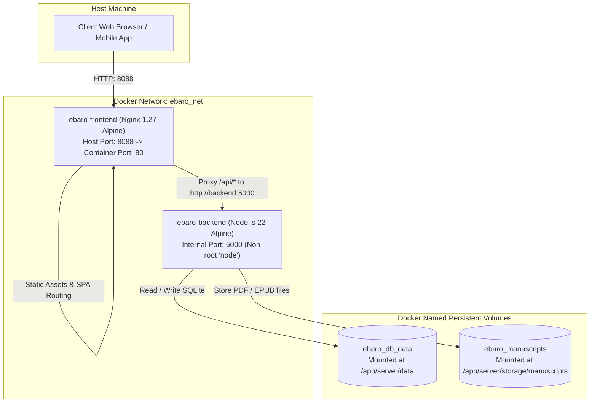

# eBaro Digital Publishing & eBook Platform — Docker Deployment Guide

This document describes the production-grade containerisation setup for the **eBaro / Veritas Press Digital Publishing Platform**.

---

## 1. Architecture Overview

The containerised application uses a decoupled multi-container architecture orchestrated via Docker Compose:



### Key Services

1. **`frontend` (`ebaro-frontend`)**:
   - **Base Image**: Multi-stage build (`node:22-alpine` builder $\rightarrow$ `nginx:1.27-alpine` runner).
   - **Role**: Serves the compiled React / Vite single-page application and acts as a high-performance reverse proxy for all `/api/` traffic.
   - **Security**: Runs unprivileged with custom `nginx.conf`, disables server tokens (`server_tokens off`), implements security headers, and enforces streaming-friendly proxying (`proxy_buffering off`, `client_max_body_size 100M`).
   - **Healthcheck**: Periodically polls `http://localhost/healthz`.

2. **`backend` (`ebaro-backend`)**:
   - **Base Image**: `node:22-alpine` with native `node:sqlite` enabled.
   - **Role**: Executes the standalone API server (`server/standalone.ts`) providing authentication, book catalogue, reader progress, manuscript serving, and payment processing.
   - **Security**: Runs as the non-root `node` user (UID/GID 1000). The host never publishes port 5000 directly; the backend is reachable strictly via the internal Docker bridge network `ebaro_net`.
   - **Healthcheck**: Periodically polls `http://localhost:5000/api/health`.

3. **Persistent Volumes**:
   - **`ebaro_db_data`**: Stores the relational SQLite database (`server/data/app.db`) containing user accounts, sessions, transactions, progress, and catalogue records.
   - **`ebaro_manuscripts`**: Stores uploaded PDF and EPUB manuscript files (`server/storage/manuscripts/`).

---

## 2. Prerequisites

- **Docker Engine**: Version 24.0.0 or higher
- **Docker Compose**: Version 2.20.0 or higher
- **WSL 2** (if running on Windows)

Verify installation:
```bash
docker --version
docker compose version
```

---

## 3. Environment Variables Configuration

Copy the example environment configuration to `.env`:

```bash
cp .env.example .env
```

### Key Variables in `.env`

| Variable | Description | Default |
|---|---|---|
| `NODE_ENV` | Application environment mode | `production` |
| `FRONTEND_PORT` | Published host port for web traffic | `8088` |
| `BACKEND_PORT` | Internal backend port (container network only) | `5000` |
| `HOST` | Backend listener binding | `0.0.0.0` |
| `SESSION_SECRET` | Secret key for session encryption & tokens | Secure 64-char string |
| `ADMIN_DEFAULT_PASSWORD` | Fallback initial admin password | Configurable |
| `MAX_BODY_SIZE_MB` | Manuscript upload size limit in MB | `100` |

---

## 4. Quick Start: Starting & Stopping the Stack

### Start all services in the background:
```bash
docker compose up -d
```

### View container status & health:
```bash
docker compose ps
```
*Both `ebaro-backend` and `ebaro-frontend` should show `Up (healthy)`.*

### Access the application:
- **Web Application**: [http://localhost:8088](http://localhost:8088)
- **API Health Check**: [http://localhost:8088/api/health](http://localhost:8088/api/health)
- **Frontend Health Check**: [http://localhost:8088/healthz](http://localhost:8088/healthz)

### View real-time logs:
```bash
# All services
docker compose logs -f

# Backend only
docker compose logs -f backend

# Frontend only
docker compose logs -f frontend
```

### Restart all services:
```bash
docker compose restart
```

### Stop all services (preserving database volumes):
```bash
docker compose down
```

---

## 5. Rebuilding After Code Modifications

When application code or dependencies change, rebuild the Docker images:

```bash
# Rebuild and start in one step
docker compose up -d --build

# Or rebuild specific services
docker compose build frontend
docker compose build backend
docker compose up -d
```

---

## 6. Backup & Restore (Database & Manuscripts)

Data persists inside named Docker volumes (`ebaro_db_data` and `ebaro_manuscripts`).

### Backing up the SQLite Database:
```bash
# Create a hot SQLite database backup without downtime
docker compose exec backend cp /app/server/data/app.db /app/server/data/app.db.bak

# Copy the backup out to the host
docker cp ebaro-backend:/app/server/data/app.db.bak ./app_backup_$(date +%Y%m%d_%H%M%S).db
```

### Backing up Manuscripts:
```bash
# Archive manuscripts to host tarball
docker run --rm -v ebaro_manuscripts:/manuscripts -v $(pwd):/backup alpine tar czf /backup/manuscripts_$(date +%Y%m%d).tar.gz -C /manuscripts .
```

### Restoring Manuscripts:
```bash
docker run --rm -v ebaro_manuscripts:/manuscripts -v $(pwd):/backup alpine sh -c "cd /manuscripts && tar xzf /backup/manuscripts_*.tar.gz"
```

---

## 7. Troubleshooting & Common Scenarios

### Port 8088 is already in use on host
If port 8088 conflicts with another service, change `FRONTEND_PORT` in your `.env` file:
```ini
FRONTEND_PORT=8090
```
Then run:
```bash
docker compose up -d
```

### Backend database permission errors
The backend container runs as the `node` user (UID 1000). The `Dockerfile.backend` automatically sets directory ownership. If a volume was mounted with incorrect permissions, reset ownership:
```bash
docker compose exec -u root backend chown -R node:node /app/server/data /app/server/storage
```

### Inspecting Backend Container Shell
```bash
docker compose exec backend sh
```

### Inspecting Nginx Logs Inside Container
```bash
docker compose exec frontend cat /var/log/nginx/access.log
docker compose exec frontend cat /var/log/nginx/error.log
```
