# UnderStoryBooks

<div align="center">

**A Digital Sanctuary for Timeless Literature, Somali Cultural Heritage, and Interactive Multilingual Learning**

[](https://www.typescriptlang.org/)
[](https://react.dev/)
[](https://vitejs.dev/)
[](https://nodejs.org/)
[](https://www.sqlite.org/)
[](https://www.postgresql.org/)
[](https://www.docker.com/)
[](https://kubernetes.io/)
[](https://github.com/walikhalil480-art/UnderStoryBooks/actions)

</div>

---

## A. Project Introduction

**UnderStoryBooks** (branded inside the interface as **UNDERSTORY • Editions & Digital Archive**) is a full-stack digital book-reading, publishing, and cultural preservation platform engineered with React 18, TypeScript, Node.js 22, native SQLite (`node:sqlite` in WAL mode), and PostgreSQL 16.

### The Problem It Solves
Readers and educators across East Africa and the global diaspora face fragmented access to both world literary classics and authentic Somali cultural literature (*Maktabadda Buugaagta Af-Soomaaliga*). Existing platforms rarely combine:
1. **High-craft in-browser reading** across multiple formats (Archival PDF via PDF.js, structured EPUB via a custom ZIP/OPF/XHTML parser, and customizable Web/Text typography) without requiring third-party reader software.
2. **Direct regional payment accessibility** supporting Horn of Africa and East African mobile money ecosystems (**EVC Plus**, **Zaad**, **Sahal**, and **M-Pesa** via Sifalo Pay and Safaricom Daraja 2.0) alongside international **Visa / Mastercard** checkout.
3. **Rigorous provenance and copyright governance**, ensuring every title carries verifiable licensing metadata, magic-byte manuscript validation, and DMCA/rights takedown workflows.
4. **Multilingual children's literacy** with synchronized karaoke-style word highlighting and comprehension quizzes across Somali, English, and Arabic.

---

## B. Screenshots and Visual Presentation

All screenshots below are captured directly from the live **UnderStoryBooks** application running at desktop resolution (`1440×900`).

### 1. Homepage & Editorial Showcase
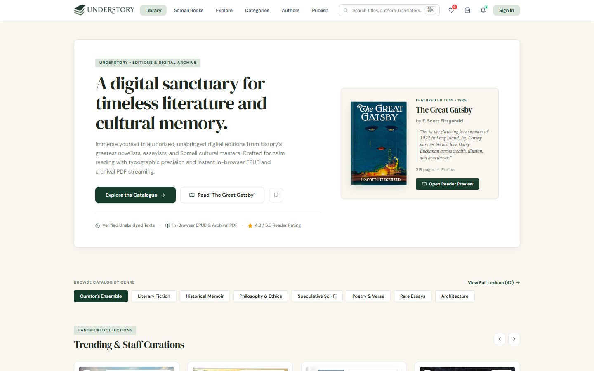

### 2. Curated Books Catalogue & Multi-Faceted Filtering
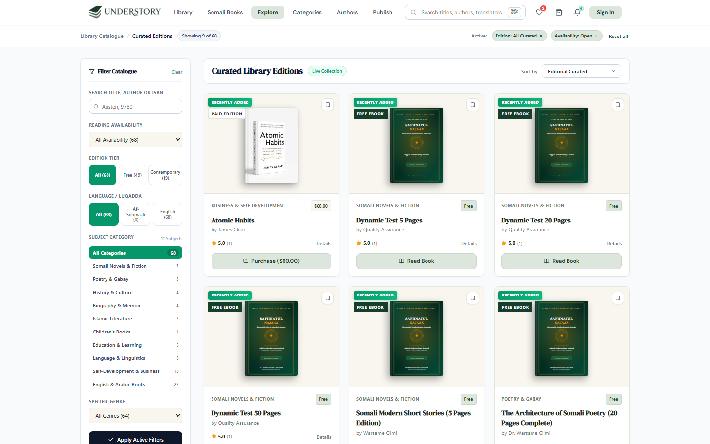

### 3. Individual Book Details & Provenance Record
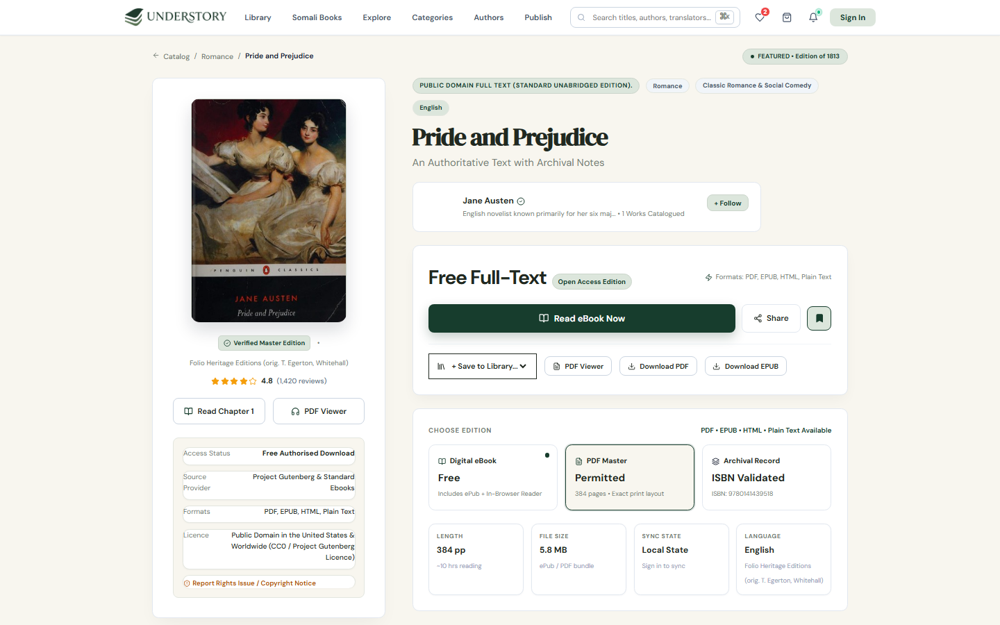

### 4. In-Browser Multi-Format Reading Interface
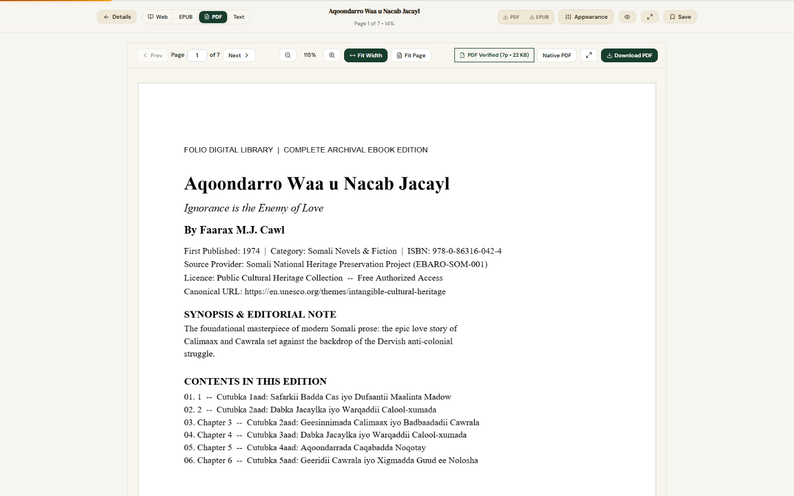

### 5. Reader Dashboard & Live Reading Velocity Analytics
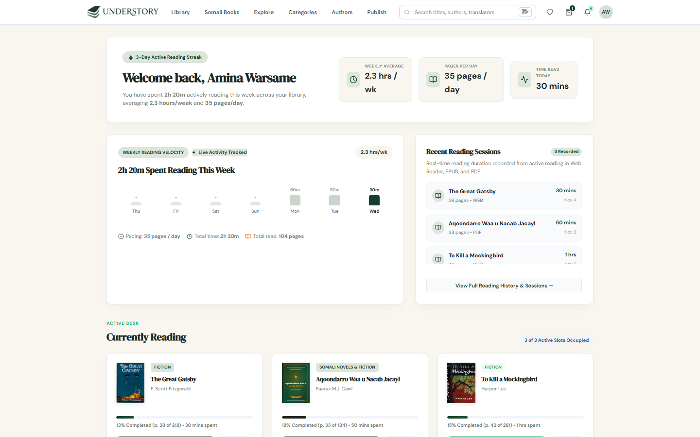

### 6. Instant Digital Checkout (EVC Plus, Zaad, Sahal, M-Pesa & Card)
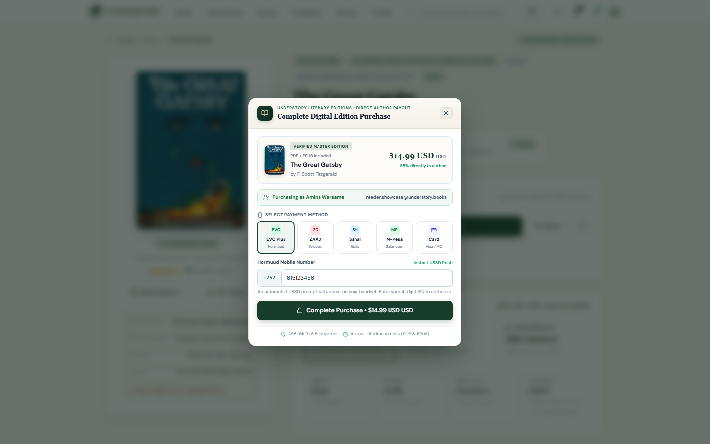

### 7. Author & Publisher Manuscript Submission Studio
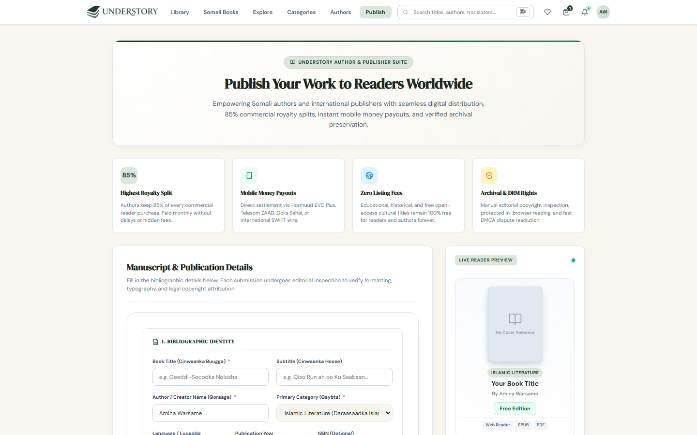

### 8. Member Authentication Portal
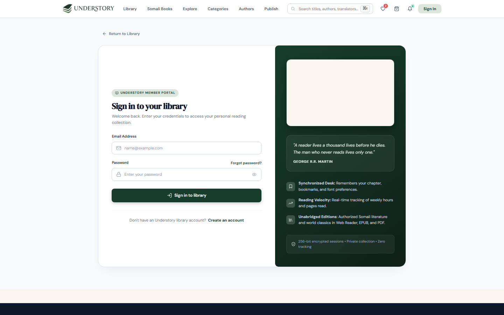

### 9. Administrator Catalogue, Moderation & Financial Console
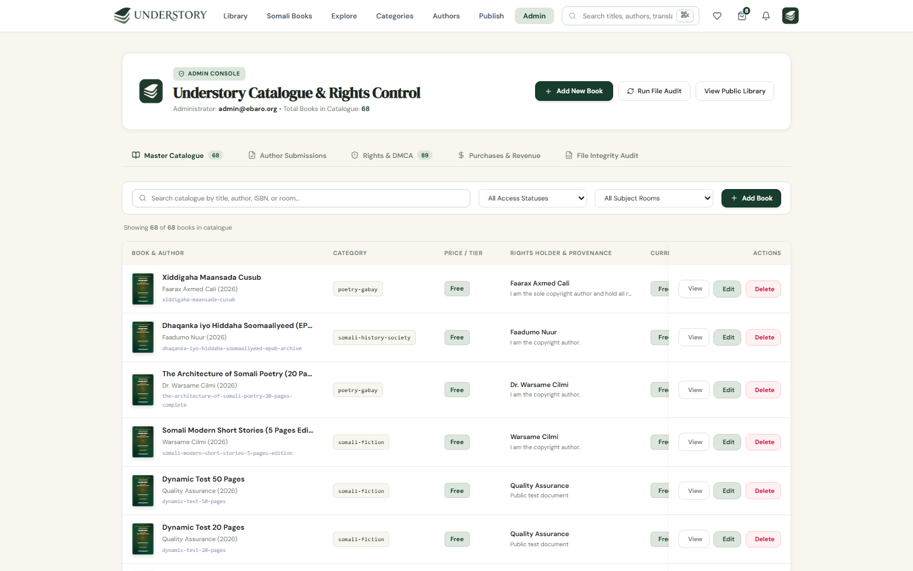

---

## C. Features

### Fully Implemented & Verified Features

| Domain | Implemented Capabilities |
| :--- | :--- |
| **User Authentication & Security** | Full account registration (`POST /api/auth/register`), sign-in (`POST /api/auth/signin`), session sign-out (`POST /api/auth/signout`), password reset token generation (`POST /api/auth/forgot-password` & `/api/auth/reset-password`), authenticated password change (`POST /api/auth/change-password`), and profile management (`PUT /api/auth/profile`). Passwords use `crypto.scryptSync` with 16-byte random salts and `crypto.timingSafeEqual` verification. |
| **Book Discovery & Browsing** | Searchable and filterable catalogue of 68+ curated world classics and Somali literary works (`#explore`, `#somali-books`, `#free-books`, `#categories`, `#authors`, `#collections`), plus live external bibliographic search via the Open Library API proxy (`GET /api/books/search-openlibrary`). |
| **Book Details & Provenance** | Dedicated bibliographic view (`#book-details`) displaying ISBN, publication year, source provider, copyright status, licence evidence, available formats (`PDF`, `EPUB`, `HTML`, `Plain Text`), and a one-click rights/takedown reporting modal. |
| **In-Browser Reading Suite** | Unified 4-mode reader (`#reader`) supporting: **Web Reader** (structured chapters), **EPUB Reader** (`EpubReaderView.tsx` backed by custom server-side ZIP/OPF/NCX/XHTML parsing in `server/epubParser.ts`), **Archival PDF Reader** (`PdfReaderView.tsx` powered by `pdfjs-dist` with zoom, page jump, and canvas rendering), and **Plain Text** mode. Includes customizable font size, line width, and color themes (`ivory`, `sepia`, `slate`, `obsidian`). |
| **User Dashboard & Reading Progress** | Personal library desk (`#my-library`) tracking shelf statuses (`reading`, `saved`, `completed`), per-book chapter and scroll progress (`POST /api/library/progress`), bookmarks (`POST /api/library/bookmarks`), download history, and weekly reading velocity metrics. |
| **Free & Paid Access Control** | Server-enforced entitlement gates on `/api/reader/:bookId/*` and `/api/download/:bookId/:format`. Free open-access titles stream and download immediately for signed-in readers; commercial titles (`paid_purchase`) require an active record in `purchase_entitlements` (or administrator role). |
| **Payment & Checkout Workflow** | Centered checkout modal (`CheckoutModal.tsx`) supporting 5 payment methods: **EVC Plus**, **Zaad**, **Sahal**, **M-Pesa**, and **Card**. Integrates `server/paymentService.ts` with Sifalo Pay and Safaricom Daraja 2.0 (with deterministic sandbox simulation when `SIFALO_SANDBOX=true` / `MPESA_SANDBOX=true` and live API calls when disabled), HMAC webhook verification (`POST /api/payments/webhook/:provider`), and digital receipt generation. |
| **Author Publishing Studio** | End-to-end manuscript upload (`POST /api/author/upload-manuscript`) supporting raw binary streaming and multipart uploads up to 50 MB, magic-byte inspection (`%PDF-` and `PK\x03\x04` EPUB signatures), cover image upload, royalty tier selection, and submission tracking (`GET /api/author-submissions/mine`). |
| **Administrator Console** | Role-protected dashboard (`#admin`) with 5 operational tabs: **Master Catalogue** (add/edit/delete books, upload manuscripts, toggle access status), **Author Submissions** (inspect uploaded PDF/EPUB manuscripts, approve to auto-publish into the live catalogue, or reject with review notes), **Rights & DMCA** (resolve copyright complaints), **Purchases & Revenue** (revenue ledger, transaction history, and one-click order refunds with automatic entitlement revocation), and **File Integrity Audit** (verify cover images and manuscript binaries on disk). |
| **Children's Multilingual Stories** | Interactive storybook module (`ChildrenStoriesSection.tsx` & `KidsStoryReaderModal.tsx`) with trilingual text (Somali, English, Arabic), synchronized word-level audio alignment (`GET/POST /api/children-stories/:id/alignment`), comprehension quizzes (`POST /api/children-stories/:id/lesson-submit`), and XP/badge progression (`GET/POST /api/kids/progress`). |

### Planned / Partially Implemented Features

- **Outbound Transactional Email Delivery (Planned):** Password reset tokens (`POST /api/auth/forgot-password`) are generated and stored in the `password_resets` table and returned in development responses, but an external SMTP/SendGrid email transport is not yet wired.
- **Full SQL Query Cutover to PostgreSQL (Partially Implemented):** PostgreSQL 16 runs as a stateful service in Docker Compose and Kubernetes, is verified via live TCP health checks (`checkPostgresConnection()`), and includes a complete schema/data migration script (`scripts/migrate_sqlite_to_postgres.cjs`), while the primary runtime query layer in `server/db.ts` executes synchronous queries against the embedded WAL-mode SQLite engine (`server/data/folio.sqlite`).
- **Automated Monthly Author Payout Disbursement (Planned):** Author revenue splits and platform commissions are calculated in the Admin Financials ledger, while automated bank/mobile-money payout scheduling is planned for a future release.

---

## D. Technology Stack

### Frontend
- **React 18.3 (`react`, `react-dom`)** — Component-driven single-page application architecture with custom hook-based state and hash-route navigation.
- **TypeScript 5.6 (`typescript`)** — End-to-end static typing shared across frontend components (`src/types/books.ts`) and backend API handlers.
- **Vite 5.4 (`vite`, `@vitejs/plugin-react`)** — Fast ES module bundler and development server with custom API middleware mounting.
- **PDF.js (`pdfjs-dist` 6.4.299)** — Client-side HTML5 Canvas rendering of archival PDF manuscripts with dedicated Web Worker (`public/pdf.worker.min.mjs`).
- **Three.js (`three` 0.186)** — WebGL 3D visual enhancements for interactive book presentation components.
- **Lucide React (`lucide-react`)** — Consistent editorial iconography across navigation, reader controls, and admin tools.

### Backend
- **Node.js 22 LTS** — Server runtime leveraging native `node:http`, `node:crypto`, `node:zlib`, `node:fs`, and `node:sqlite`.
- **tsx (`tsx` 4.21)** — Zero-config TypeScript execution for the standalone production server (`server/standalone.ts`) and migration utilities.
- **Dual-Mode HTTP Server (`server/standalone.ts` & `server/apiPlugin.ts`)** — Runs either as a standalone production HTTP server on port `5000` (with static asset serving and `/api/*` routing) or mounted directly inside Vite's development server.

### Database
- **Node.js Native SQLite (`node:sqlite` `DatabaseSync`)** — Primary embedded relational database (`server/data/folio.sqlite`) configured with `PRAGMA journal_mode = WAL` and `PRAGMA foreign_keys = ON` across 25 normalized tables.
- **PostgreSQL 16 (`postgres:16-alpine`, `pg` 8.20)** — Containerized relational database deployed in Docker Compose and Kubernetes `StatefulSet`, paired with `scripts/migrate_sqlite_to_postgres.cjs` for relational synchronization and `/api/health` readiness probes.

### Authentication and Security
- **Node.js `node:crypto` (`scryptSync`, `timingSafeEqual`, `randomBytes`, `createHmac`)** — Cryptographic password hashing, 256-bit bearer session tokens (`sessions` table), and HMAC-SHA256 payment webhook signature verification.
- **In-Memory Sliding-Window Rate Limiter** — Per-IP request throttling (`checkRateLimit` in `server/apiPlugin.ts`) protecting authentication and submission endpoints.

### File Storage and Document Processing
- **Custom EPUB 2/3 Parser (`server/epubParser.ts`)** — Native ZIP Central Directory extractor using `node:zlib` (`inflateRawSync`) that parses `META-INF/container.xml`, OPF spine manifests, NCX/nav tables of contents, and chapter XHTML into clean reader-ready HTML and plain text.
- **PDF Stream & Generator (`server/ebookFiles.ts`)** — Validates uploaded PDF/EPUB binary headers (magic bytes), streams byte-range PDF documents (`Accept-Ranges: bytes`), and dynamically synthesizes structured PDF/EPUB/HTML/TXT editions for public-domain catalogue works.

### UI and Styling
- **Custom Editorial CSS Design System** — Modular stylesheets (`src/index.css`, `src/styles/luxuryStorefront.css`, `src/styles/modernReader.css`, `src/styles/publishAndAdmin.css`, `src/styles/responsiveEnhancements.css`) paired with Tailwind CSS utilities (`tailwindcss` 3.4, `postcss`, `autoprefixer`).

### DevOps and Infrastructure
- **Docker & Docker Compose (`Dockerfile.frontend`, `Dockerfile.backend`, `docker-compose.yml`)** — Multi-stage container builds (Nginx 1.27 Alpine frontend reverse proxy + Node 22 Alpine backend + PostgreSQL 16 Alpine).
- **Nginx 1.27 (`nginx.conf`)** — Serves the compiled SPA, proxies `/api/` traffic to the backend service (`client_max_body_size 50M`), and enforces explicit `.mjs` JavaScript MIME types for PDF.js Web Workers.
- **Kubernetes & Helm (`k8s/`, `helm/understory/`)** — Production-grade Kubernetes manifests and parameterized Helm chart with `Deployment`, `StatefulSet`, `Service`, `Ingress`, `ConfigMap`, `Secret`, and `HorizontalPodAutoscaler` resources.
- **Argo CD (`argocd/application.yaml`)** — GitOps declarative continuous delivery manifest targeting the `understory` namespace with automated self-healing and pruning.
- **GitHub Actions (`.github/workflows/ci-cd.yml`)** — 5-stage automated CI/CD pipeline (Code Quality, Build & Test, Trivy Security Scan, Multi-Arch Docker Hub Push, and Deployment Verification).

### Testing and Development Tools
- **End-to-End Verification Suites (`tests/*.cjs`)** — Automated verification scripts testing API contracts, authentication, PDF/EPUB integrity, payment flows, and Kubernetes cluster readiness.

---

## E. System Architecture

### Architectural Overview
UnderStoryBooks follows a decoupled client-server architecture:
1. **Presentation Layer (React SPA + Nginx Reverse Proxy):** In production, Nginx serves static bundles on port `80` (mapped to `8088` in Docker Compose or `NodePort 30080` in Kubernetes) and proxies all `/api/*` requests to the backend container over the internal network.
2. **Application & Domain Layer (`server/apiPlugin.ts`, `server/paymentService.ts`, `server/epubParser.ts`, `server/ebookFiles.ts`):** A stateless HTTP middleware router processes REST requests, enforces bearer token authentication and role-based access control (`reader` vs. `admin`), validates uploaded binary manuscripts, and orchestrates mobile-money/card payment sessions.
3. **Persistence Layer (`server/db.ts` + File Volume):** Relational metadata, user accounts, reading progress, orders, and entitlements are persisted in WAL-mode SQLite (`server/data/folio.sqlite`) with PostgreSQL 16 (`postgres:5432`) synchronization and persistent volume storage for uploaded manuscripts (`public/ebooks/manuscripts/`).

### System Architecture Diagram

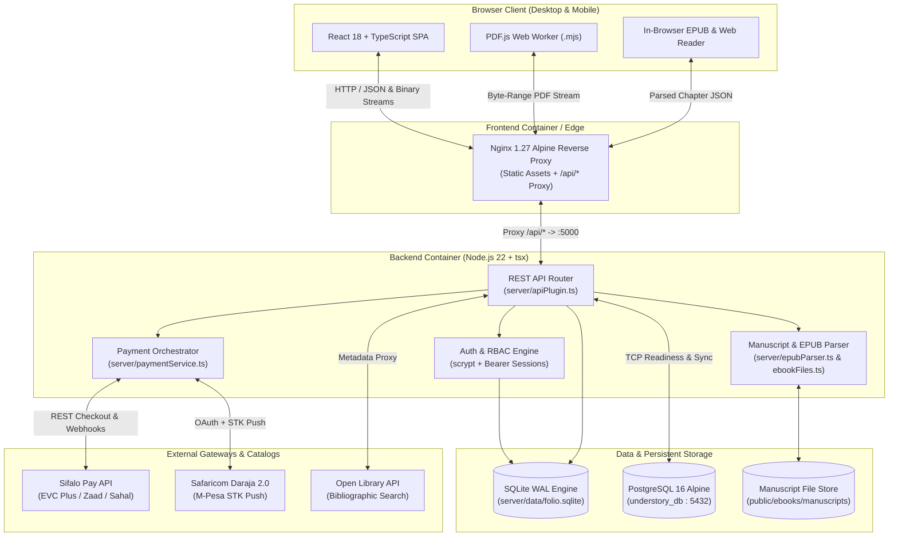

---

## F. Project Structure

```text
UnderStoryBooks/
├── .github/
│   └── workflows/
│       └── ci-cd.yml                  # 5-stage GitHub Actions CI/CD pipeline
├── argocd/
│   └── application.yaml               # Argo CD GitOps Application manifest
├── docs/
│   └── screenshots/                   # Real desktop screenshots of the platform
├── helm/
│   └── understory/                    # Parameterized Helm chart for Kubernetes deployment
│       ├── Chart.yaml
│       ├── values.yaml
│       └── templates/                 # K8s Deployment, StatefulSet, Service, Ingress, HPA
├── k8s/                               # Standalone Kubernetes manifests & namespace configs
├── public/
│   ├── covers/                        # Local verified book cover artwork
│   ├── ebooks/                        # Generated and uploaded PDF/EPUB manuscripts
│   ├── illustrations/                 # Children's storybook illustrations
│   └── pdf.worker.min.mjs             # Dedicated PDF.js rendering Web Worker
├── scripts/
│   └── migrate_sqlite_to_postgres.cjs # Automated SQLite-to-PostgreSQL 16 migration tool
├── server/
│   ├── apiPlugin.ts                   # Core REST API router (53 endpoints, auth, RBAC, catalog)
│   ├── catalogAudit.ts                # Automated cover image and provenance audit utility
│   ├── db.ts                          # 25-table relational schema, migrations, and seed logic
│   ├── ebookFiles.ts                  # Binary PDF/EPUB generator, streamer, and validator
│   ├── epubParser.ts                  # Zero-dependency ZIP/OPF/XHTML EPUB 2/3 parser
│   ├── paymentService.ts              # Sifalo Pay, M-Pesa Daraja 2.0, Card & webhook engine
│   └── standalone.ts                  # Standalone Node.js production HTTP server entry point
├── src/
│   ├── components/                    # React UI views, readers, modals, and dashboards
│   │   ├── AdminCataloguePage.tsx     # 5-tab Administrator moderation & financials console
│   │   ├── AuthorSubmissionsPage.tsx  # Author publishing studio & manuscript upload
│   │   ├── BookDetailsPage.tsx        # Bibliographic record, provenance, and edition selector
│   │   ├── CheckoutModal.tsx          # Centered 5-method instant payment modal
│   │   ├── ChildrenStoriesSection.tsx # Multilingual children's storybook hub
│   │   ├── EpubReaderView.tsx         # Reflowable in-browser EPUB reader component
│   │   ├── ExploreLibraryPage.tsx     # Faceted library catalogue browser
│   │   ├── KidsStoryReaderModal.tsx   # Synchronized audio-word alignment & quiz reader
│   │   ├── MyLibraryPage.tsx          # Personal reading desk, velocity stats, and shelves
│   │   ├── PdfReaderView.tsx          # PDF.js canvas reader with zoom & page navigation
│   │   ├── ReaderPage.tsx             # Unified 4-mode reading wrapper (Web/EPUB/PDF/Text)
│   │   └── SomaliBooksPage.tsx        # Curated Somali literary heritage showcase
│   ├── data/
│   │   ├── books.ts                   # Curated world & Somali literary catalogue metadata
│   │   ├── childrenStories.ts         # Trilingual children's stories & quiz questions
│   │   └── fullTexts.ts               # Unabridged chapter texts for instant Web Reader access
│   ├── services/
│   │   └── folioApi.ts                # Typed frontend API client & session token manager
│   ├── styles/                        # Modular editorial CSS stylesheets
│   ├── types/
│   │   └── books.ts                   # Shared TypeScript interfaces for books, orders, users
│   ├── App.tsx                        # Root application state, routing, and gate orchestration
│   └── main.tsx                       # React DOM mounting entry point
├── tests/                             # Automated integration, payment, and K8s test suites
│   ├── platform_verification.cjs      # Full-stack API, auth, reader, and payment verification
│   ├── k8s_verification.cjs           # Kubernetes manifest & Helm chart contract checks
│   └── ...
├── .env.example                       # Documented environment variable template
├── Dockerfile.backend                 # Node.js 22 Alpine backend container image definition
├── Dockerfile.frontend                # Multi-stage Vite build + Nginx 1.27 Alpine image
├── docker-compose.yml                 # 3-container orchestration (Frontend, Backend, Postgres)
├── nginx.conf                         # Production Nginx SPA & API reverse-proxy configuration
├── package.json                       # Dependencies and npm scripts
└── vite.config.ts                     # Vite bundler config with mounted API plugin
```

---

## G. Installation and Local Development

### Prerequisites
- **Node.js** `>= 22.0.0` (required for native `node:sqlite` support)
- **npm** `>= 10.0.0`
- **Git**

### Step-by-Step Local Setup

1. **Clone the repository:**
   ```bash
   git clone https://github.com/walikhalil480-art/UnderStoryBooks.git
   cd UnderStoryBooks
   ```

2. **Install dependencies:**
   ```bash
   npm install
   ```

3. **Configure environment variables:**
   Copy `.env.example` to `.env` (optional for local development, as safe defaults are built in):
   ```bash
   cp .env.example .env
   ```

4. **Start the unified development server (Frontend + Backend API on one port):**
   ```bash
   npm run dev
   ```
   Vite mounts `folioApiPlugin()` from `server/apiPlugin.ts` directly into the dev server. Open **`http://localhost:5173`** in your browser.

5. **Build for production and run the standalone server (optional):**
   ```bash
   npm run build
   npm start
   ```
   This compiles the TypeScript/React frontend into `dist/` and starts `server/standalone.ts` serving both the static frontend and `/api/*` endpoints on **`http://localhost:5000`**.

---

## H. Environment Variables

All environment variables below are verified in `server/standalone.ts`, `server/db.ts`, `server/paymentService.ts`, and `docker-compose.yml`. See [`.env.example`](.env.example) for a ready-to-copy template.

| Variable | Purpose | Required |
| :--- | :--- | :--- |
| `NODE_ENV` | Runtime environment mode (`development` or `production`) | No (defaults to `development`) |
| `HOST` | Network interface bind address for `server/standalone.ts` | No (defaults to `0.0.0.0`) |
| `PORT` | HTTP listening port for the standalone backend server | No (defaults to `5000`) |
| `FRONTEND_PORT` | Host port mapped to Nginx in `docker-compose.yml` | No (defaults to `8088`) |
| `BACKEND_PORT` | Internal container port for the backend API service | No (defaults to `5000`) |
| `DB_HOST` | Hostname for PostgreSQL TCP health check and migration | No (defaults to `postgres` / `localhost`) |
| `DB_PORT` | Port number for PostgreSQL connection | No (defaults to `5432`) |
| `POSTGRES_DB` | PostgreSQL database name | No (defaults to `understory_db`) |
| `POSTGRES_USER` | PostgreSQL database username | No (defaults to `understory_user`) |
| `POSTGRES_PASSWORD` | PostgreSQL password for container initialization | Yes (in Docker/K8s production) |
| `DATABASE_URL` | Full PostgreSQL connection URI used by `scripts/migrate_sqlite_to_postgres.cjs` | No (constructed from `DB_*` if omitted) |
| `ADMIN_DEFAULT_PASSWORD` | Initial password used when seeding the default administrator account (`admin@ebaro.org`) | No (defaults to `AdminPass2026!` in dev) |
| `SIFALO_SANDBOX` | Enables deterministic sandbox simulation for EVC Plus / Zaad / Sahal (`true` or `false`) | No (defaults to `true` unless set to `'false'`) |
| `SIFALO_API_USER` | Live Sifalo Pay API username when `SIFALO_SANDBOX=false` | Conditional (Required for live Sifalo Pay) |
| `SIFALO_API_KEY` | Live Sifalo Pay API key when `SIFALO_SANDBOX=false` | Conditional (Required for live Sifalo Pay) |
| `MPESA_SANDBOX` | Enables sandbox simulation for Safaricom M-Pesa STK Push (`true` or `false`) | No (defaults to `true` unless set to `'false'`) |
| `MPESA_CONSUMER_KEY` | Safaricom Daraja 2.0 OAuth Consumer Key | Conditional (Required for live M-Pesa) |
| `MPESA_CONSUMER_SECRET` | Safaricom Daraja 2.0 OAuth Consumer Secret | Conditional (Required for live M-Pesa) |
| `MPESA_PASSKEY` | Safaricom Lipa Na M-Pesa Online Passkey | Conditional (Required for live M-Pesa) |
| `MPESA_SHORTCODE` | M-Pesa business shortcode | No (defaults to `174379` sandbox shortcode) |
| `PAYMENT_WEBHOOK_SECRET` | Shared secret used to verify `x-webhook-signature` HMAC-SHA256 headers on `/api/payments/webhook/:provider` | Recommended in production |

---

## I. API Documentation

The backend exposes **53 verified REST endpoints** in [`server/apiPlugin.ts`](server/apiPlugin.ts). Protected routes expect an `Authorization: Bearer <token>` header.

### 1. System, Health & Catalogue Discovery
| Method | Endpoint | Auth | Description |
| :--- | :--- | :--- | :--- |
| `GET` | `/api/health` | Public | Liveness & readiness probe returning PostgreSQL status, user/book counts, and uptime. |
| `GET` | `/api/audit/images` | Public | Runs cover image duplication and provenance verification across the catalogue. |
| `GET` | `/api/books/catalog` | Public | Returns catalogue summary statistics and all relational `books` records. |
| `GET` | `/api/books/published` | Public | Returns dynamically published books from approved author submissions. |
| `GET` | `/api/books/search-openlibrary?q=` | Public | Searches Open Library with local SQLite caching (`book_metadata_cache`). |

### 2. Authentication & Member Profile
| Method | Endpoint | Auth | Description |
| :--- | :--- | :--- | :--- |
| `POST` | `/api/auth/register` | Public | Registers a new reader account, hashes password via `scrypt`, and issues a bearer token. |
| `POST` | `/api/auth/signin` | Public | Authenticates credentials and returns `{ token, user, library }`. |
| `POST` | `/api/auth/signout` | Bearer | Revokes the active session token in the `sessions` table. |
| `GET` | `/api/auth/me` | Bearer | Returns the current user's profile and synchronized library state. |
| `POST` | `/api/auth/forgot-password` | Public | Generates a 30-minute password reset token in `password_resets`. |
| `POST` | `/api/auth/reset-password` | Public | Resets a user's password using a valid reset token and invalidates prior sessions. |
| `POST` | `/api/auth/change-password` | Bearer | Verifies current password and updates to a new `scrypt` hash. |
| `PUT` | `/api/auth/profile` | Bearer | Updates user display name and email address. |

### 3. In-Browser Reader & Verified Downloads
| Method | Endpoint | Auth | Description |
| :--- | :--- | :--- | :--- |
| `GET` | `/api/reader/:bookId/content` | Bearer* | Returns chapter content (`?chapter=0`) after verifying free/paid entitlement. |
| `GET` | `/api/reader/:bookId/fulltext` | Bearer* | Returns all chapters and metadata for full-text Web Reader mode. |
| `GET` | `/api/reader/:bookId/pdf` | Bearer* | Streams the book's PDF binary (`application/pdf`) with byte-range support. |
| `GET` | `/api/reader/:bookId/epub` | Bearer* | Parses the book's `.epub` archive on the fly and returns structured chapters & TOC JSON. |
| `GET` | `/api/download/:bookId/:format` | Bearer | Downloads verified `pdf`, `epub`, `html`, or `txt` binary and logs to `download_history`. |

### 4. Personal Library, Progress & Bookmarks
| Method | Endpoint | Auth | Description |
| :--- | :--- | :--- | :--- |
| `GET` | `/api/library` | Bearer | Returns user shelf statuses, reading progress, bookmarks, preferences, and downloads. |
| `POST` | `/api/library/status` | Bearer | Adds/updates a book on the user's shelf (`reading`, `saved`, `completed`, or `remove`). |
| `POST` | `/api/library/progress` | Bearer | Saves current chapter, scroll percentage, page number, and preferred reader format. |
| `POST` | `/api/library/bookmarks` | Bearer | Creates or toggles a chapter/page bookmark with optional reader note. |
| `DELETE` | `/api/library/bookmarks` | Bearer | Removes a specific bookmark (`?id=`). |
| `PUT` | `/api/library/preferences` | Bearer | Updates typography settings (`readerFontSize`, `readerTheme`, `readerLineWidth`). |

### 5. Payments, Checkout & Entitlements
| Method | Endpoint | Auth | Description |
| :--- | :--- | :--- | :--- |
| `GET` | `/api/payments/methods` | Public | Lists enabled payment gateways (`evc_plus`, `zaad`, `sahal`, `mpesa`, `card`). |
| `POST` | `/api/purchases/checkout` | Bearer | Initiates an order, processes payment via `paymentService.ts`, and grants entitlement. |
| `GET` | `/api/purchases/verify/:orderId` | Bearer | Verifies order status, entitlement activation, and receipt details. |
| `POST` | `/api/payments/webhook/:provider` | HMAC | Asynchronous payment provider webhook receiver with signature verification. |
| `GET` | `/api/purchases/mine` | Bearer | Lists all active purchased book IDs and order records for the signed-in user. |
| `POST` | `/api/purchases/refund` | Admin | Issues a full refund, records in `refund_records`, and revokes `purchase_entitlements`. |

### 6. Author Publishing & Copyright Governance
| Method | Endpoint | Auth | Description |
| :--- | :--- | :--- | :--- |
| `POST` | `/api/author/upload-manuscript` | Bearer | Streams or uploads a PDF/EPUB manuscript (up to 50 MB) with magic-byte validation. |
| `POST` | `/api/author-submissions` | Bearer | Submits book metadata, cover image, pricing, and manuscript path for editorial review. |
| `GET` | `/api/author-submissions/mine` | Bearer | Returns all submissions created by the authenticated author. |
| `GET` | `/api/author-submissions/:id/manuscript` | Bearer | Streams the author's own submitted manuscript for preview. |
| `POST` | `/api/rights/takedown` | Public | Submits a copyright infringement or rights takedown notice (`copyright_complaints`). |

### 7. Administrator Console Endpoints
| Method | Endpoint | Auth | Description |
| :--- | :--- | :--- | :--- |
| `GET` | `/api/admin/financials` | Admin | Comprehensive revenue summary, provider breakdown, orders, refunds, and notifications. |
| `GET` | `/api/admin/transactions` | Admin | Returns historical purchase and payment ledger records. |
| `GET` | `/api/admin/notifications` | Admin | Returns real-time sale and refund notifications (`admin_notifications`). |
| `POST` | `/api/admin/notifications/mark-read` | Admin | Marks all administrator notifications as read. |
| `POST` | `/api/admin/notifications/:id/read` | Admin | Marks a single administrator notification as read. |
| `GET` | `/api/admin/author-submissions` | Admin | Lists all pending, approved, and rejected author manuscript submissions. |
| `GET` | `/api/admin/author-submissions/:id/manuscript` | Admin | Streams or downloads a submitted manuscript (`?download=1`) for editorial inspection. |
| `POST` | `/api/admin/author-submissions/:id/review` | Admin | Approves (auto-publishing to live catalogue) or rejects an author submission. |
| `GET` | `/api/admin/copyright-complaints` | Admin | Lists all submitted copyright and DMCA complaints. |
| `POST` | `/api/admin/copyright-complaints/:id/resolve` | Admin | Resolves a complaint (`dismissed` or `removed_from_public` with immediate takedown). |
| `GET` | `/api/admin/audit` | Admin | Audits physical file existence and byte sizes for all catalogue manuscripts. |
| `POST` | `/api/admin/books` | Admin | Creates a new book directly in the master catalogue. |
| `POST` | `/api/admin/books/:id/edit` | Admin | Updates book metadata, price, cover, or manuscript binary in the catalogue. |
| `POST` | `/api/admin/books/:id/status` | Admin | Updates a book's `access_status` (`full_download_available`, `paid_purchase`, etc.). |
| `DELETE` | `/api/admin/books/:id` | Admin | Permanently deletes a book from the catalogue and removes any corresponding submission. |

### 8. Children's Multilingual Stories & Learning
| Method | Endpoint | Auth | Description |
| :--- | :--- | :--- | :--- |
| `GET` | `/api/children-stories` | Public | Returns all multilingual children's stories (`children_stories`). |
| `GET` | `/api/children-stories/:id` | Public | Returns full story text, vocabulary, and quiz data for a single story. |
| `GET` | `/api/children-stories/:id/audio/:lang` | Public | Streams story narration audio (`so`, `en`, `ar`). |
| `GET` | `/api/children-stories/:id/alignment` | Public | Returns word-level audio timestamps (`?lang=so`). |
| `POST` | `/api/children-stories/:id/alignment` | Bearer | Saves calibrated word-level audio alignment timestamps. |
| `DELETE` | `/api/children-stories/:id/alignment/:lang` | Bearer | Resets custom audio alignment for a language. |
| `GET` | `/api/kids/progress` | Public/Bearer | Returns XP, level, badges, and story completion history (`kids_learning_progress`). |
| `POST` | `/api/kids/progress` | Public/Bearer | Updates reading completion, quiz score, and earned badges. |
| `POST` | `/api/children-stories/:id/lesson-submit` | Public/Bearer | Grades a comprehension quiz attempt and awards XP (`kids_lesson_attempts`). |

---

## J. Database Design

`server/db.ts` defines **25 normalized relational tables** across 5 core domains:
1. **Identity & Sessions (`users`, `sessions`, `password_resets`, `user_preferences`)** — Manages reader/admin accounts, bearer tokens with expiration timestamps, and reader typography settings.
2. **Catalogue & Provenance (`books`, `book_metadata_cache`, `verification_audit_log`, `copyright_complaints`)** — Stores bibliographic records, licensing evidence, manuscript paths, and rights governance logs.
3. **Reader Activity (`user_library`, `reading_progress`, `bookmarks`, `reading_history`, `download_history`)** — Tracks shelf organization, chapter/page progress, annotations, and binary downloads.
4. **Commerce & Entitlements (`orders`, `payment_transactions`, `purchase_entitlements`, `refund_records`, `purchases`, `payment_provider_configs`, `admin_notifications`)** — Provides an auditable double-entry-style order lifecycle from checkout initiation to entitlement grant or admin refund.
5. **Author Publishing & Kids Learning (`author_submissions`, `children_stories`, `children_story_alignments`, `kids_learning_progress`, `kids_lesson_attempts`)** — Powers the publishing pipeline and interactive children's literacy progression.

### Entity-Relationship Diagram (Core Schema)

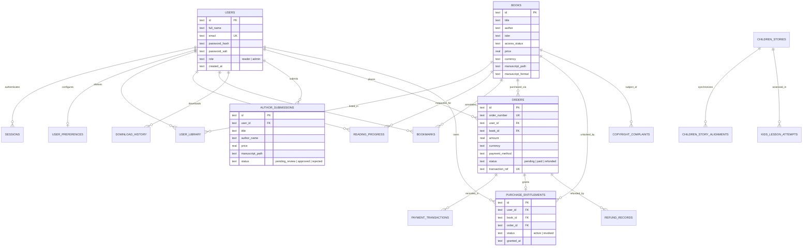

---

## K. Docker and Deployment

### 1. Docker Compose (3-Container Production Stack)
`docker-compose.yml` orchestrates three health-checked services on the `understory-network` bridge network:
- **`understory-frontend`** (`Dockerfile.frontend` — Nginx 1.27 Alpine on port `8088:80`)
- **`understory-backend`** (`Dockerfile.backend` — Node 22 Alpine on port `5000`)
- **`understory-postgres`** (`postgres:16-alpine` on port `5432` with persistent volume `postgres_data`)

Run the entire stack with a single command:
```bash
docker compose up -d --build
```
Verify container health:
```bash
docker ps
curl http://localhost:8088/api/health
```

### 2. Kubernetes & Helm Deployment (`helm/understory/` & `k8s/`)
The repository includes both raw Kubernetes manifests (`k8s/`) and a parameterized Helm chart (`helm/understory/`) that deploys into the `understory` namespace with three core services: `frontend` (`NodePort 30080`), `backend` (`ClusterIP 5000`), and `postgres` (`ClusterIP 5432` backed by a `StatefulSet`).

Deploy with Helm on Minikube or any Kubernetes cluster:
```bash
helm upgrade --install understory ./helm/understory \
  --namespace understory \
  --create-namespace
```
Check deployed resources and open the frontend service:
```bash
kubectl get pods,svc -n understory
minikube service frontend -n understory
```

### 3. GitOps Continuous Delivery with Argo CD (`argocd/application.yaml`)
Apply the declarative Argo CD `Application` manifest to automatically sync `helm/understory` from the `main` branch of `https://github.com/walikhalil480-art/UnderStoryBooks.git`:
```bash
kubectl apply -f argocd/application.yaml
```

### 4. GitHub Actions CI/CD Pipeline (`.github/workflows/ci-cd.yml`)
Every push to `main` triggers the **Understory CI/CD Pipeline** across 5 automated stages:
1. **Stage 1 — Code Quality & Type Check:** Runs `npm ci` and `npm run lint` (`tsc --noEmit`).
2. **Stage 2 — Build & Automated Tests:** Compiles the production Vite bundle (`npm run build`) and runs the full verification suite (`npm test`).
3. **Stage 3 — Container Security Scanning:** Builds the Docker image and runs **Aqua Security Trivy** (`aquasecurity/trivy-action`) to scan for `CRITICAL` and `HIGH` vulnerabilities.
4. **Stage 4 — Docker Hub Build & Push:** Authenticates via `DOCKER_USERNAME` and `DOCKER_PASSWORD` secrets and publishes multi-tagged images (`latest` and commit SHA) for `khalilart/ebaro-frontend` and `khalilart/ebaro-backend`.
5. **Stage 5 — Deployment Verification:** Validates the Helm chart (`helm lint ./helm/understory`) and executes Kubernetes manifest contract checks (`node tests/k8s_verification.cjs`).

---

## L. Testing

All test scripts are located in `tests/` and verified via Node.js.

| Command | Scope & What It Verifies |
| :--- | :--- |
| `npm run lint` | Runs `tsc --noEmit` across the entire TypeScript codebase to verify zero type or syntax errors. |
| `npm test` | Executes [`tests/platform_verification.cjs`](tests/platform_verification.cjs) (auto-starting the backend server if not already running) to test catalogue endpoints, user registration/sign-in, protected reading gates, PDF/EPUB binary delivery, payment checkout, and admin routes. |
| `node tests/k8s_verification.cjs` | Verifies [`helm/understory`](helm/understory), [`k8s/`](k8s/), and [`argocd/application.yaml`](argocd/application.yaml) structure, service ports, and Kubernetes readiness contracts. |
| `node tests/verify_payment_system.cjs` | Tests end-to-end checkout, receipt verification, entitlement unlocking, and admin refund revocation across EVC Plus, Zaad, Sahal, M-Pesa, and Card providers. |

---

## M. Security Considerations

- **Cryptographic Password Storage:** User passwords are never stored in plaintext. `server/db.ts` hashes passwords using `crypto.scryptSync(password, salt, 64)` with a unique 16-byte random salt per user and verifies digests using constant-time `crypto.timingSafeEqual`.
- **Bearer Session Tokens & Revocation:** Authentication issues 256-bit random hex tokens (`crypto.randomBytes(32)`) persisted in the `sessions` table with explicit `expires_at` timestamps. Signing out or resetting a password immediately deletes active session rows.
- **Role-Based Access Control (RBAC):** All `/api/admin/*` and `/api/purchases/refund` routes verify `user.role === 'admin'` on the server before executing privileged catalogue, moderation, or financial operations.
- **Server-Side Entitlement Gates:** Paid books (`access_status = 'paid_purchase'` or `price > 0`) are protected at the API layer (`/api/reader/:bookId/*` and `/api/download/:bookId/:format`) by querying active rows in `purchase_entitlements`.
- **Binary Manuscript Magic-Byte Validation:** `POST /api/author/upload-manuscript` inspects raw binary file headers to verify genuine `%PDF-` (`0x25504446`) or EPUB ZIP (`0x504B0304`) signatures and sanitizes filenames (`path.basename`) to prevent path traversal.
- **Rate Limiting & Webhook Verification:** Authentication endpoints enforce per-IP sliding-window rate limits (`checkRateLimit`), and `/api/payments/webhook/:provider` validates `x-webhook-signature` using HMAC-SHA256 (`crypto.createHmac`).
- **Container Vulnerability Scanning:** Trivy scans built container images on every CI run to catch OS and dependency vulnerabilities before registry publication.

---

## N. Future Improvements

The following enhancements are planned for upcoming iterations of **UnderStoryBooks**:
- [ ] **Complete PostgreSQL Runtime Query Cutover (`Planned`):** Transition runtime SQL queries in `server/db.ts` from synchronous `node:sqlite` to a pooled `pg` query layer so multiple horizontally scaled backend pods can share state without SQLite volume locks.
- [ ] **Transactional Email Integration (`Planned`):** Connect `POST /api/auth/forgot-password` and purchase receipts to an SMTP / SendGrid / AWS SES provider.
- [ ] **Offline PWA Reading Mode (`Planned`):** Add Service Worker caching via IndexedDB so authenticated readers can read unlocked EPUB and PDF editions offline on mobile devices.
- [ ] **Automated Author Royalty Payouts (`Planned`):** Schedule automated monthly mobile-money disbursements to authors based on the net revenue ledger in `orders`.

---

## O. Contribution

Contributions, bug reports, and cultural archive additions are welcome!

1. **Fork** the repository on GitHub (`https://github.com/walikhalil480-art/UnderStoryBooks`).
2. **Create a feature branch:**
   ```bash
   git checkout -b feat/your-feature-name
   ```
3. **Make your changes** and ensure both type-checking and automated verification pass:
   ```bash
   npm run lint
   npm test
   node tests/k8s_verification.cjs
   ```
4. **Commit your changes** with a clear, descriptive commit message:
   ```bash
   git commit -m "feat: describe your enhancement clearly"
   ```
5. **Push** to your fork and open a **Pull Request** against the `main` branch.

---

## P. License

No `LICENSE` file is currently committed to this repository. Under standard GitHub and international copyright defaults, all rights are reserved by the repository owner (**Khalil Abdi Wali** — [@walikhalil480-art](https://github.com/walikhalil480-art)) unless an explicit open-source license file is added. Public-domain literary works included in the catalogue retain their respective Project Gutenberg / Standard Ebooks / open-access licenses as documented in each book's provenance record.
